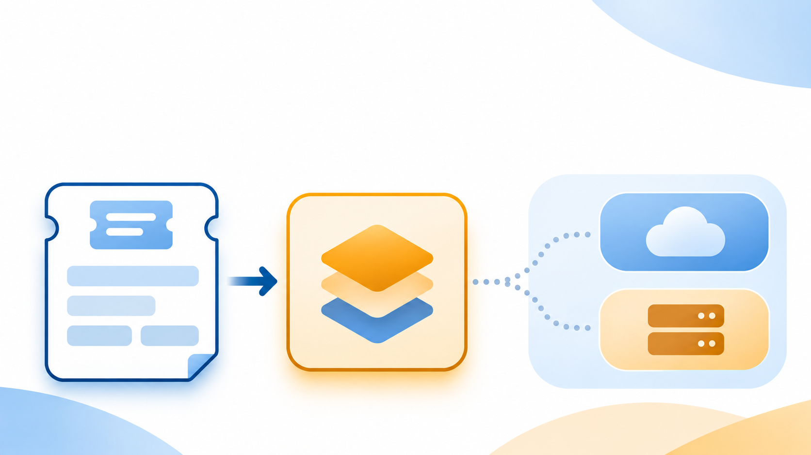

# AI Model API: Choose the Right Model and Access Route

Suppose your product needs to turn support tickets into a few structured fields: issue type, urgency, and a short summary. Searching for an **AI model API** brings up model catalogues, direct provider APIs, and services that put many models behind one endpoint. Each is relevant, but they answer different questions.

First choose a model for the job: what it must read, what it must return, and which behaviors the application depends on. Then choose an access route: the endpoint, account, provider, and terms through which that particular model is served. A familiar request format can shorten integration work, but it does not establish that every model or route supports the same features.

For the ticket example, the useful starting point is not a model count. It is a testable requirement: accept the ticket text and return fields your application can validate. If attachments matter, image or document input becomes a separate requirement. Once the shortlist is real, the route question becomes much smaller.

*First match the model to the task; then verify how that model is served.*

## Start with the job the model must do

Write the smallest useful task description before browsing model names. For the ticket feature, that might be: “Given ticket text, return `issue_type`, `urgency`, and `summary` in a form the application can check.” Decide what counts as a usable answer. If the team needs tool calls, image inputs, a particular context length, or a fixed output structure, say so now; otherwise a model that looks suitable in a catalogue may fail at the operation the app actually uses.

A catalogue helps narrow the field. [OpenRouter](https://openrouter.ai/docs/guides/overview/models), for example, documents filters for output modality and supported parameters and returns model metadata. [Moduck’s model catalogue](https://moduck.ai/models) displays categories, specifications, and available configuration prices. Those are discovery surfaces. The candidate still needs an exact model ID and version, a supported operation, and a route-specific check of the feature that matters to your application. That check prevents a promising catalogue card from becoming an unusable integration plan.

For the ticket task, begin with text input and a structured response requirement. If tickets include screenshots, revise the shortlist to models and routes that accept the image input you actually send. That change is a different capability test, not merely a different model name.

## A model name is not an API route

A model identifies the capability you want to use; the route identifies who receives the request and under which account and interface. A publisher can offer its own direct API. A multi-model service may offer one account and endpoint for several models. An SDK that standardizes application code is another layer again: it may simplify calls without changing the company that serves or bills them.

| Published example | What the route can simplify | What to confirm for your chosen model |
|---|---|---|
| [OpenAI](https://developers.openai.com/api/docs/) direct API | Work close to OpenAI’s own model and API documentation | Exact model, operation, account access, feature support, and current terms |
| [OpenRouter](https://openrouter.ai/docs/guides/overview/models) multi-model API | Discover and address models through its documented catalogue and metadata | Exact model/provider route, supported parameters, price fields and conditional overrides |
| [Moduck](https://moduck.ai/models) multi-model API | Explore listed models and their published configurations through one platform | Exact listed configuration, account availability, operation, units and current terms |

This is a map of published access paths, not a performance or price ranking. A route that is convenient for comparing models may be a poor fit if the feature your app requires is missing there. Conversely, a direct provider integration may be more work to change later but can make sense when the app depends on that provider’s own API behavior. [Google’s integration guidance](https://ai.google.dev/gemini-api/docs/partner-integration) distinguishes its native SDK, direct API, and compatibility layer, with different trade-offs; the specific path and feature set matter.

## The published price is one condition of the route

Before comparing two price cards, check what each card measures. Text calls may have separate input and output token rates; image, audio, and video calls can use a generated asset, duration, resolution, or another unit. [Moduck’s billing guide](https://moduck.ai/pilot/help/understand-pricing) explicitly advises checking a model’s unit and any minimums or extras before comparing costs. Its public pricing page also lists a **$10 minimum top-up and no fixed monthly fee** as of November 13, 2026; that is a published account term, not a charge observed in a customer account. [Moduck’s current pricing page](https://moduck.ai/pilot/pricing) is the place to recheck it.

The same caution applies to direct providers. [OpenAI’s public pricing](https://developers.openai.com/api/docs/pricing) separates model, context, processing tier, cached input, cache writes, and output. [Google’s Gemini API pricing](https://ai.google.dev/gemini-api/docs/pricing) distinguishes model, tier, batch or other processing modes, caching, and some tool charges. A low displayed input figure can therefore describe a different workload from the one you plan to run. This article does not turn unlike model configurations into a single cheapest-provider table.

Price is only one term of the route. Check the account’s model access and limits, the provider or intermediary that handles the request, and the data terms relevant to your application. Public documentation can tell you what a route publishes; it cannot tell you that your account is eligible, what your production latency will be, or what an unrun request will cost on an invoice.

## Validate the pair before making it a dependency

Name the pair you intend to use: **exact model/version + exact endpoint/provider route + operation**. For the ticket feature, retain routine and ambiguous tickets and the expected `issue_type`, `urgency`, and `summary` fields. Check the current documentation for that pair, including supported input types, structured output behavior, rate unit, limits, and data terms. Then, in your own authorized account, run the representative requests, review the returned fields and usage records, and decide whether the behavior is acceptable. Those are steps for the reader to perform; no account or model call was made for this article.

Do not turn a successful text request into a blanket compatibility verdict. If a fallback route is planned, test it against the same task and confirm that a retry is safe. [OpenAI’s route guidance](https://developers.openai.com/blog/designing-failover-across-openai-model-providers) makes the distinction: another approved route helps only when the operation can be repeated safely and the alternative meets the workload’s requirements. A matching model label alone does not establish that.

## Make the next step fit the route

If one provider’s specific feature or control is central to the product, its direct API is a sensible first route to investigate. If you need to compare several candidate models or consolidate access, a multi-model route may be useful **when it exposes the exact model and behavior you need under acceptable terms**. Either choice still depends on the application’s own validation.

If Moduck is on your shortlist, [Read the documentation](https://docs.moduck.ai/); check the current model and account requirements before requesting a key. The public catalogue and pricing pages help you assess that route; they do not replace an account-specific feature and billing check.
